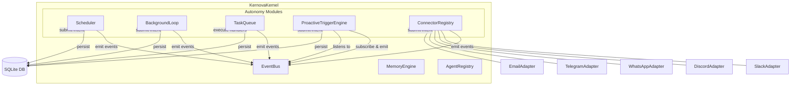
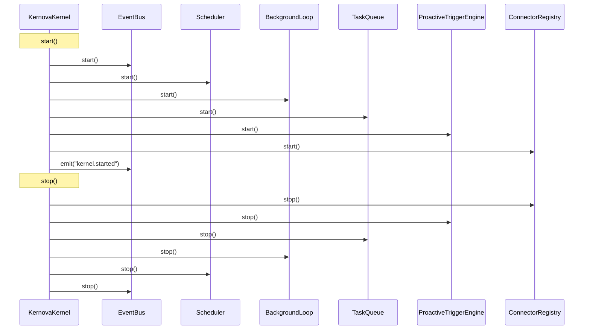

# Design Document: Core Autonomy

## Overview

The Core Autonomy feature adds five modules to the Kernova runtime that enable agents to operate independently: **Scheduler**, **BackgroundLoop**, **TaskQueue**, **ProactiveTriggerEngine**, and **ConnectorRegistry**. Together they allow agents to execute tasks on a schedule, monitor conditions continuously, process queued work with priorities, react to runtime events, and communicate through external channels.

Each module follows the established Kernova module pattern (constructor receives EventBus + config, exposes `start()`/`stop()` lifecycle). All state is persisted via SQLite using better-sqlite3 in the same style as the existing `EventStore`. The KernovaKernel is extended with getter properties to expose each module.

### Design Rationale

- **Modularity over monolith**: Each capability is a standalone module so it can be developed, tested, and replaced independently.
- **EventBus-native**: All modules emit events for every significant action, maintaining the Kernova observability guarantee.
- **SQLite persistence**: Reuses the proven better-sqlite3 + WAL mode pattern from EventStore for zero-config development storage.
- **Adapter pattern for connectors**: Channel connectors implement a shared interface, making new channels addable without modifying the registry.

---

## Architecture

### High-Level System Diagram



### Module Startup/Shutdown Order



### Directory Structure

```
packages/core/src/
├── scheduler/
│   ├── scheduler.ts          # Scheduler module class
│   ├── scheduler-store.ts    # SQLite persistence layer
│   └── cron-utils.ts         # Cron parsing/validation helpers
├── background-loop/
│   ├── background-loop.ts    # BackgroundLoop module class
│   └── loop-store.ts         # SQLite persistence layer
├── task-queue/
│   ├── task-queue.ts         # TaskQueue module class
│   ├── queue-store.ts        # SQLite persistence layer
│   └── dead-letter.ts        # Dead-letter queue logic
├── triggers/
│   ├── trigger-engine.ts     # ProactiveTriggerEngine class
│   └── trigger-store.ts      # SQLite persistence layer
├── channels/
│   ├── connector-registry.ts # ConnectorRegistry class
│   ├── channel-adapter.ts    # ChannelAdapter interface
│   └── adapters/
│       ├── slack-adapter.ts
│       ├── discord-adapter.ts
│       ├── whatsapp-adapter.ts
│       ├── telegram-adapter.ts
│       └── email-adapter.ts
└── kernel.ts                 # Extended KernovaKernel

packages/types/src/
├── autonomy.ts               # All autonomy-related type definitions
└── index.ts                  # Re-exports autonomy.ts
```

---

## Components and Interfaces

### 1. Scheduler

**Responsibility**: Register, persist, and execute cron-based scheduled jobs.

```typescript
// packages/core/src/scheduler/scheduler.ts

export interface SchedulerConfig {
  dataDir: string;
  maxExecutionTimeout?: number; // default: 300_000 ms
}

export class Scheduler {
  constructor(eventBus: EventBus, config: SchedulerConfig);

  /** Start the scheduler, loading persisted jobs from SQLite */
  async start(): Promise<void>;

  /** Stop the scheduler, cancelling all pending timers */
  async stop(): Promise<void>;

  /** Register a new scheduled job */
  register(job: ScheduledJobInput): ScheduledJob;

  /** Remove a scheduled job by ID */
  remove(jobId: KernovaId): void;

  /** List all registered jobs */
  list(): ScheduledJob[];

  /** Get a specific job by ID */
  get(jobId: KernovaId): ScheduledJob | undefined;
}
```

**Internal Mechanics**:
- Uses `setTimeout` chaining to schedule each job's next tick (not `setInterval`).
- After each execution (or on startup), calculates the next cron match and schedules a timer.
- Maintains a `Map<KernovaId, NodeJS.Timeout>` of active timers.
- Tracks `lastExecutionAt` and a `running` flag per job to detect overlaps and missed runs.
- Cron parsing delegated to `cron-parser` library (the `cron-parser` npm package).

### 2. BackgroundLoop

**Responsibility**: Continuously poll monitor functions at configurable intervals and submit intents when conditions are detected.

```typescript
// packages/core/src/background-loop/background-loop.ts

export type MonitorFunction = (context: unknown | null) => Promise<unknown | null | undefined> | unknown | null | undefined;

export interface BackgroundLoopConfig {
  dataDir: string;
}

export class BackgroundLoopModule {
  constructor(eventBus: EventBus, config: BackgroundLoopConfig);

  async start(): Promise<void>;
  async stop(): Promise<void>;

  /** Register a new background loop */
  register(input: BackgroundLoopInput): BackgroundLoopDef;

  /** Pause an active loop */
  pause(loopId: KernovaId): void;

  /** Resume a paused loop */
  resume(loopId: KernovaId): void;

  /** Remove a loop entirely */
  remove(loopId: KernovaId): void;

  /** List all registered loops */
  list(): BackgroundLoopDef[];
}
```

**Internal Mechanics**:
- Each loop has its own `setTimeout` chain (not `setInterval`) so drift is avoided.
- The previous monitor return value is stored in a `Map<KernovaId, unknown>` and passed to each invocation.
- On error in the monitor function, the loop logs, emits an error event, and schedules the next tick normally.
- Serializes loop metadata (id, interval, state) to SQLite but NOT the monitor function reference (functions are re-registered on startup by the application).

### 3. TaskQueue

**Responsibility**: Priority-ordered async task execution with concurrency control, retry logic, and dead-letter handling.

```typescript
// packages/core/src/task-queue/task-queue.ts

export type TaskHandler = (payload: unknown) => Promise<unknown>;

export interface TaskQueueConfig {
  dataDir: string;
  concurrency?: number;        // default: 5, range: 1–50
  maxRetries?: number;         // default: 3
  baseDelay?: number;          // default: 1000 ms
  maxDelay?: number;           // default: 30000 ms
  taskTimeout?: number;        // default: 30000 ms
  maxQueueDepth?: number;      // default: 1000
  shutdownTimeout?: number;    // default: 10000 ms
}

export class TaskQueue {
  constructor(eventBus: EventBus, config: TaskQueueConfig);

  async start(): Promise<void>;
  async stop(): Promise<void>;

  /** Enqueue a task item */
  enqueue(input: TaskItemInput): TaskItem;

  /** Get queue statistics */
  stats(): QueueStats;

  /** Query dead-lettered items */
  deadLetters(filter?: DeadLetterFilter): DeadLetterItem[];

  /** Replay a dead-lettered item */
  replay(taskId: KernovaId): TaskItem;
}
```

**Internal Mechanics**:
- Maintains an in-memory processing loop that dequeues from SQLite ordered by `priority ASC, enqueued_at ASC` (critical=0, high=1, medium=2, low=3).
- A semaphore tracks active slots. When a slot opens, the next item is dequeued.
- Retry backoff: `Math.min(baseDelay * 2^(attempt-1), maxDelay)`.
- Task timeout uses `AbortController` + `setTimeout` to cancel a promise.
- On shutdown, waits up to `shutdownTimeout` ms for in-flight tasks, then force-cancels.

### 4. ProactiveTriggerEngine

**Responsibility**: Evaluate event-driven rules and submit intents when conditions are met.

```typescript
// packages/core/src/triggers/trigger-engine.ts

export type TriggerCondition = (event: KernovaEvent) => boolean;
export type TriggerAction = { goal: string; metadata?: Record<string, unknown> };

export interface TriggerEngineConfig {
  dataDir: string;
}

export class ProactiveTriggerEngine {
  constructor(eventBus: EventBus, config: TriggerEngineConfig);

  async start(): Promise<void>;
  async stop(): Promise<void>;

  /** Register a new trigger rule */
  register(input: TriggerRuleInput): TriggerRule;

  /** Remove a trigger rule */
  remove(ruleId: KernovaId): void;

  /** Enable a disabled rule */
  enable(ruleId: KernovaId): void;

  /** Disable a rule without removing */
  disable(ruleId: KernovaId): void;

  /** List all rules */
  list(): TriggerRule[];
}
```

**Internal Mechanics**:
- On `start()`, loads persisted rules from SQLite and subscribes to the EventBus for each enabled rule's pattern.
- Stores a `Map<KernovaId, string>` of subscription IDs so rules can be individually unsubscribed.
- Cooldown tracking: `Map<KernovaId, number>` storing `lastFiredAt` timestamps. Events within cooldown are silently dropped.
- Condition functions are NOT serialized to SQLite (same approach as BackgroundLoop). Only rule metadata is persisted; the application re-registers conditions on startup.

### 5. ConnectorRegistry

**Responsibility**: Manage channel connector adapters for external platform communication.

```typescript
// packages/core/src/channels/connector-registry.ts

export interface ConnectorRegistryConfig {
  dataDir: string;
  deliveryTimeout?: number; // default: 30_000 ms
}

export class ConnectorRegistry {
  constructor(eventBus: EventBus, config: ConnectorRegistryConfig);

  async start(): Promise<void>;
  async stop(): Promise<void>;

  /** Register a new channel connector */
  register(input: ConnectorInput): ConnectorDef;

  /** Start a specific connector */
  async connect(connectorId: KernovaId): Promise<void>;

  /** Stop a specific connector */
  async disconnect(connectorId: KernovaId): Promise<void>;

  /** Send an outbound message */
  async send(request: OutboundMessageRequest): OutboundMessageResult;

  /** Get status of all connectors */
  status(): ConnectorStatus[];
}
```

### 6. ChannelAdapter Interface

```typescript
// packages/core/src/channels/channel-adapter.ts

export type ConnectionState = 'disconnected' | 'connecting' | 'connected' | 'reconnecting' | 'failed';

export interface ChannelAdapter {
  /** Channel type identifier */
  readonly channelType: ChannelType;

  /** Current connection state */
  readonly state: ConnectionState;

  /** Connect to the external platform */
  connect(): Promise<void>;

  /** Disconnect gracefully */
  disconnect(): Promise<void>;

  /** Send a message to the platform */
  send(message: OutboundMessage): Promise<DeliveryReceipt>;

  /** Register callback for inbound messages */
  onMessage(handler: (msg: RawInboundMessage) => void): void;

  /** Register callback for connection state changes */
  onStateChange(handler: (state: ConnectionState) => void): void;
}
```

---

## Data Models

### Type Definitions (`@kernova/types/src/autonomy.ts`)

```typescript
import type { KernovaId, Timestamp, Priority } from './base.js';

// ─── Scheduler ───────────────────────────────────────────────

export interface ScheduledJob {
  id: KernovaId;
  name: string;
  cronExpression: string;
  target: ScheduleTarget;
  enabled: boolean;
  createdAt: Timestamp;
  updatedAt: Timestamp;
  lastExecutionAt?: Timestamp;
  nextExecutionAt?: Timestamp;
}

export interface ScheduledJobInput {
  name: string;                    // max 128 chars
  cronExpression: string;          // 5-field cron
  target: ScheduleTarget;
}

export interface ScheduleTarget {
  type: 'intent' | 'agent';
  id?: KernovaId;                    // agent ID if type is 'agent'
  goal: string;                    // intent goal
  metadata?: Record<string, unknown>;
}

// ─── Background Loop ─────────────────────────────────────────

export interface BackgroundLoopDef {
  id: KernovaId;
  name: string;
  intervalMs: number;              // 1000–86_400_000
  state: LoopState;
  createdAt: Timestamp;
  updatedAt: Timestamp;
}

export type LoopState = 'active' | 'paused' | 'removed';

export interface BackgroundLoopInput {
  id?: KernovaId;                    // optional caller-provided ID
  name: string;
  intervalMs: number;
  monitor: MonitorFunction;
  target?: ScheduleTarget;         // intent template for actions
}

// ─── Task Queue ──────────────────────────────────────────────

export interface TaskItem {
  id: KernovaId;
  priority: Priority;
  status: TaskStatus;
  payload: unknown;
  handler: string;                 // handler name for routing
  attempt: number;
  maxRetries: number;
  createdAt: Timestamp;
  updatedAt: Timestamp;
  scheduledAt?: Timestamp;         // for retry backoff delay
}

export type TaskStatus = 'pending' | 'running' | 'completed' | 'failed' | 'dead-lettered';

export interface TaskItemInput {
  priority?: Priority;
  payload: unknown;
  handler: string;
  maxRetries?: number;
}

export interface QueueStats {
  pending: number;
  active: number;
  completed: number;
  failed: number;
  deadLettered: number;
}

export interface DeadLetterItem {
  id: KernovaId;
  taskId: KernovaId;
  payload: unknown;
  handler: string;
  errorMessage: string;
  errorType: string;
  attempts: DeadLetterAttempt[];
  deadLetteredAt: Timestamp;
  status: 'active' | 'replayed';
}

export interface DeadLetterAttempt {
  attempt: number;
  executedAt: Timestamp;
  errorMessage: string;
}

export interface DeadLetterFilter {
  after?: Timestamp;
  before?: Timestamp;
  errorType?: string;
}

// ─── Proactive Triggers ──────────────────────────────────────

export interface TriggerRule {
  id: KernovaId;
  name: string;
  eventPattern: string;            // EventBus wildcard pattern, max 256 chars
  condition?: string;              // serialized condition description
  action: TriggerActionDef;
  enabled: boolean;
  cooldownMs: number;              // min 100, default 1000
  createdAt: Timestamp;
  updatedAt: Timestamp;
  lastFiredAt?: Timestamp;
}

export interface TriggerRuleInput {
  name: string;
  eventPattern: string;
  condition?: TriggerCondition;    // runtime function (not serialized)
  conditionDescription?: string;   // human-readable, persisted
  action: TriggerActionDef;
  cooldownMs?: number;
  enabled?: boolean;               // default true
}

export interface TriggerActionDef {
  goal: string;
  intentType?: IntentType;
  priority?: Priority;
  metadata?: Record<string, unknown>;
}

// ─── Channel Connectors ──────────────────────────────────────

export type ChannelType = 'slack' | 'discord' | 'whatsapp' | 'telegram' | 'email';

export type ConnectionState = 'disconnected' | 'connecting' | 'connected' | 'reconnecting' | 'failed';

export interface ConnectorDef {
  id: KernovaId;
  channelType: ChannelType;
  name: string;
  state: ConnectionState;
  config: ChannelConfig;
  createdAt: Timestamp;
  updatedAt: Timestamp;
}

export interface ConnectorInput {
  channelType: ChannelType;
  name: string;
  config: ChannelConfig;
}

export type ChannelConfig =
  | SlackConfig
  | DiscordConfig
  | WhatsAppConfig
  | TelegramConfig
  | EmailConfig;

export interface SlackConfig {
  type: 'slack';
  botToken: string;
  signingSecret: string;
  appId?: string;
}

export interface DiscordConfig {
  type: 'discord';
  botToken: string;
  applicationId: string;
}

export interface WhatsAppConfig {
  type: 'whatsapp';
  accessToken: string;
  phoneNumberId: string;
  verifyToken: string;
}

export interface TelegramConfig {
  type: 'telegram';
  botToken: string;
  webhookUrl?: string;
}

export interface EmailConfig {
  type: 'email';
  smtpHost: string;
  smtpPort: number;
  imapHost: string;
  imapPort: number;
  username: string;
  password: string;
  useTls?: boolean;
}

export interface ConnectorStatus {
  id: KernovaId;
  channelType: ChannelType;
  name: string;
  state: ConnectionState;
}

export interface InboundMessage {
  id: KernovaId;
  sender: string;              // max 256 chars
  channel: ChannelType;
  content: string;             // max 32_000 chars
  timestamp: Timestamp;
  connectorId: KernovaId;
  raw?: unknown;               // original platform payload
}

export interface OutboundMessage {
  content: string;
  structured?: StructuredContent;
}

export interface StructuredContent {
  attachments?: Attachment[];
  buttons?: Button[];
  embeds?: Embed[];
}

export interface Attachment {
  type: 'file' | 'image' | 'video';
  url: string;
  name?: string;
}

export interface Button {
  label: string;
  action: string;
  style?: 'primary' | 'secondary' | 'danger';
}

export interface Embed {
  title?: string;
  description?: string;
  color?: string;
  fields?: Array<{ name: string; value: string; inline?: boolean }>;
}

export interface OutboundMessageRequest {
  connectorId: KernovaId;
  recipient?: string;
  message: OutboundMessage;
}

export interface OutboundMessageResult {
  messageId: KernovaId;
  connectorId: KernovaId;
  deliveredAt?: Timestamp;
  status: 'sent' | 'failed' | 'partial';
}

export interface DeliveryReceipt {
  success: boolean;
  platformMessageId?: string;
  timestamp: Timestamp;
  error?: string;
}

export interface RawInboundMessage {
  sender: string;
  content: string;
  timestamp: string;
  raw?: unknown;
}
```

### SQLite Schema

Each module uses its own table(s) within the shared `kernova.db` database file. Tables are created via auto-migration on first `start()` (same pattern as EventStore).

#### Scheduler Tables

```sql
CREATE TABLE IF NOT EXISTS scheduled_jobs (
  id TEXT PRIMARY KEY,
  name TEXT NOT NULL UNIQUE,
  cron_expression TEXT NOT NULL,
  target_type TEXT NOT NULL,
  target_id TEXT,
  target_goal TEXT NOT NULL,
  target_metadata TEXT,
  enabled INTEGER NOT NULL DEFAULT 1,
  last_execution_at TEXT,
  next_execution_at TEXT,
  created_at TEXT NOT NULL,
  updated_at TEXT NOT NULL
);

CREATE INDEX IF NOT EXISTS idx_scheduled_jobs_name ON scheduled_jobs(name);
CREATE INDEX IF NOT EXISTS idx_scheduled_jobs_next ON scheduled_jobs(next_execution_at);
```

#### Background Loop Tables

```sql
CREATE TABLE IF NOT EXISTS background_loops (
  id TEXT PRIMARY KEY,
  name TEXT NOT NULL,
  interval_ms INTEGER NOT NULL,
  state TEXT NOT NULL DEFAULT 'active',
  created_at TEXT NOT NULL,
  updated_at TEXT NOT NULL
);
```

#### Task Queue Tables

```sql
CREATE TABLE IF NOT EXISTS task_items (
  id TEXT PRIMARY KEY,
  priority INTEGER NOT NULL,
  status TEXT NOT NULL DEFAULT 'pending',
  payload TEXT NOT NULL,
  handler TEXT NOT NULL,
  attempt INTEGER NOT NULL DEFAULT 0,
  max_retries INTEGER NOT NULL DEFAULT 3,
  scheduled_at TEXT,
  created_at TEXT NOT NULL,
  updated_at TEXT NOT NULL
);

CREATE INDEX IF NOT EXISTS idx_task_items_dequeue
  ON task_items(status, priority, created_at)
  WHERE status = 'pending';
CREATE INDEX IF NOT EXISTS idx_task_items_status ON task_items(status);

CREATE TABLE IF NOT EXISTS dead_letter_items (
  id TEXT PRIMARY KEY,
  task_id TEXT NOT NULL,
  payload TEXT NOT NULL,
  handler TEXT NOT NULL,
  error_message TEXT NOT NULL,
  error_type TEXT NOT NULL,
  attempts TEXT NOT NULL,
  dead_lettered_at TEXT NOT NULL,
  status TEXT NOT NULL DEFAULT 'active'
);

CREATE INDEX IF NOT EXISTS idx_dead_letter_date
  ON dead_letter_items(dead_lettered_at DESC);
CREATE INDEX IF NOT EXISTS idx_dead_letter_error_type
  ON dead_letter_items(error_type);
```

#### Trigger Tables

```sql
CREATE TABLE IF NOT EXISTS trigger_rules (
  id TEXT PRIMARY KEY,
  name TEXT NOT NULL,
  event_pattern TEXT NOT NULL,
  condition_description TEXT,
  action_goal TEXT NOT NULL,
  action_intent_type TEXT,
  action_priority TEXT,
  action_metadata TEXT,
  enabled INTEGER NOT NULL DEFAULT 1,
  cooldown_ms INTEGER NOT NULL DEFAULT 1000,
  last_fired_at TEXT,
  created_at TEXT NOT NULL,
  updated_at TEXT NOT NULL
);

CREATE INDEX IF NOT EXISTS idx_trigger_rules_pattern ON trigger_rules(event_pattern);
CREATE UNIQUE INDEX IF NOT EXISTS idx_trigger_rules_unique_combo
  ON trigger_rules(event_pattern, condition_description) WHERE enabled = 1;
```

### Priority Numeric Mapping

For SQLite ordering, priorities are stored as integers:
- `critical` = 0
- `high` = 1
- `medium` = 2
- `low` = 3

This allows `ORDER BY priority ASC` to yield highest-priority first.

---


## Correctness Properties

*A property is a characteristic or behavior that should hold true across all valid executions of a system — essentially, a formal statement about what the system should do. Properties serve as the bridge between human-readable specifications and machine-verifiable correctness guarantees.*

### Property 1: Cron expression validation

*For any* string, the Scheduler SHALL accept it as a valid cron expression if and only if it conforms to a five-field format (minute, hour, day-of-month, month, day-of-week) using only digits and the special characters `*`, `,`, `-`, `/`, and SHALL reject all other strings with a validation error.

**Validates: Requirements 1.2, 1.3**

### Property 2: Scheduler registration round-trip

*For any* valid ScheduledJobInput (valid cron, non-empty name ≤128 chars, valid target), registering the job and then calling `list()` SHALL return a collection containing that job with all original fields preserved and a unique assigned identifier.

**Validates: Requirements 1.1, 1.6**

### Property 3: Scheduler removal invariant

*For any* registered Scheduled_Job, calling `remove(jobId)` SHALL cause `list()` to no longer contain that job, and `get(jobId)` SHALL return undefined.

**Validates: Requirements 1.5**

### Property 4: Scheduler name uniqueness

*For any* two ScheduledJobInput objects with the same `name` field, the second `register()` call SHALL be rejected with a validation error while the first remains registered.

**Validates: Requirements 1.7**


### Property 5: Scheduler persistence survives restart

*For any* set of N registered Scheduled_Jobs, stopping and restarting the Scheduler SHALL result in `list()` returning all N jobs with their original fields and correctly recalculated `nextExecutionAt` timestamps relative to the current time.

**Validates: Requirements 1.4**

### Property 6: Missed execution detection

*For any* Scheduled_Job whose `lastExecutionAt` plus the cron interval is earlier than the current time at startup, the Scheduler SHALL emit a "scheduler.job.missed" event for each missed occurrence.

**Validates: Requirements 2.5**

### Property 7: Background loop interval bounds validation

*For any* integer N, registering a BackgroundLoop with `intervalMs = N` SHALL succeed if and only if 1000 ≤ N ≤ 86,400,000, and SHALL reject with a validation error otherwise.

**Validates: Requirements 3.2, 3.3**

### Property 8: Background loop pause/resume round-trip

*For any* active BackgroundLoop, pausing it SHALL change its state to 'paused', and subsequently resuming it SHALL restore its state to 'active', with the appropriate events emitted at each transition.

**Validates: Requirements 3.4, 3.5**

### Property 9: Background loop removal

*For any* registered BackgroundLoop (active or paused), calling `remove()` SHALL cause `list()` to no longer contain that loop.

**Validates: Requirements 3.6**


### Property 10: Background loop error resilience

*For any* BackgroundLoop whose monitor function throws an error, the loop SHALL emit a "loop.error" event, remain in 'active' state, and continue scheduling the next polling cycle.

**Validates: Requirements 3.7**

### Property 11: Background loop persistence with state preservation

*For any* set of BackgroundLoops in mixed active/paused states, stopping and restarting the module SHALL preserve each loop's state — active loops resume polling, paused loops remain paused.

**Validates: Requirements 3.1, 3.8**

### Property 12: Monitor result determines action

*For any* BackgroundLoop monitor invocation, if the monitor returns a non-null, non-undefined value then an intent SHALL be submitted, and if it returns null or undefined then no intent SHALL be submitted.

**Validates: Requirements 4.1, 4.2**

### Property 13: Monitor context threading

*For any* sequence of BackgroundLoop monitor invocations, each invocation SHALL receive the return value of the previous invocation as its context argument, with null supplied on the first invocation after registration or resumption.

**Validates: Requirements 4.3**

### Property 14: Task enqueue with priority defaults

*For any* valid TaskItemInput, enqueuing SHALL produce a TaskItem with status "pending", a unique ID, and priority "medium" when no priority is specified.

**Validates: Requirements 5.1, 5.2**


### Property 15: Priority dequeue ordering

*For any* set of pending TaskItems with mixed priorities and enqueue timestamps, the TaskQueue SHALL dequeue them in strict priority order (critical > high > medium > low), and in FIFO order within the same priority level.

**Validates: Requirements 5.3**

### Property 16: Queue depth enforcement

*For any* configured maximum queue depth N, when the number of pending items equals N, the next enqueue attempt SHALL be rejected with a "queue full" error.

**Validates: Requirements 5.6, 5.7**

### Property 17: Exponential backoff calculation

*For any* task attempt number A (where A ≥ 1), the retry delay SHALL equal `min(baseDelay × 2^(A-1), maxDelay)`, producing strictly increasing delays until the cap is reached.

**Validates: Requirements 6.2**

### Property 18: Retry exhaustion leads to dead-lettering

*For any* TaskItem with `maxRetries = N`, after exactly N consecutive execution failures the item SHALL be moved to the Dead_Letter_Queue and SHALL NOT be retried further.

**Validates: Requirements 6.3, 6.4**

### Property 19: Concurrency limit enforcement

*For any* configured concurrency limit C, the TaskQueue SHALL never have more than C tasks in "running" status simultaneously.

**Validates: Requirements 6.1**

### Property 20: Dead-letter data completeness

*For any* dead-lettered TaskItem, the Dead_Letter_Queue record SHALL contain the original payload, final error message, error type string, and a timestamp for each execution attempt.

**Validates: Requirements 7.1**


### Property 21: Dead-letter replay resets state

*For any* dead-lettered TaskItem, replaying it SHALL produce a new pending TaskItem with attempt count reset to 0, original priority preserved, and the DLQ record marked as "replayed".

**Validates: Requirements 7.2**

### Property 22: Queue statistics accuracy

*For any* queue state, the `stats()` method SHALL return counts where `pending + active + completed + failed + deadLettered` accounts for every TaskItem that has been enqueued, and each count matches the actual persisted state.

**Validates: Requirements 7.5**

### Property 23: Trigger event pattern validation

*For any* string, the ProactiveTriggerEngine SHALL accept it as a valid event pattern if and only if it consists of dot-separated segments where each segment is either a non-empty alphanumeric string or `*`, the total length is ≤ 256 characters, and SHALL reject all other strings.

**Validates: Requirements 8.2, 8.3**

### Property 24: Trigger enabled/disabled state controls evaluation

*For any* Trigger_Rule, while disabled the engine SHALL NOT evaluate or fire for matching events, and when re-enabled the engine SHALL resume evaluation for matching events.

**Validates: Requirements 8.5, 8.6, 9.9**

### Property 25: Conditional trigger fires only when condition is true

*For any* event matching a Trigger_Rule pattern: if the rule has a condition that returns true, the action SHALL fire; if the condition returns false, no action SHALL be taken; if no condition is defined, the action SHALL fire unconditionally.

**Validates: Requirements 9.1, 9.2, 9.3, 9.4**

### Property 26: Cooldown enforcement

*For any* Trigger_Rule with cooldown C milliseconds, if the rule fires at time T, subsequent matching events arriving before T + C SHALL be ignored without evaluation.

**Validates: Requirements 9.8**


### Property 27: Inbound message normalization

*For any* valid RawInboundMessage (sender ≤ 256 chars, non-empty content ≤ 32,000 chars, valid ISO 8601 timestamp), the ConnectorRegistry SHALL normalize it into an InboundMessage preserving all fields and submit an intent with content as goal and sender/channel/timestamp as metadata.

**Validates: Requirements 11.1, 11.3**

### Property 28: Inbound message validation rejects invalid input

*For any* RawInboundMessage missing a required field (sender, content, timestamp), or with empty content, or with content exceeding 32,000 characters, the ConnectorRegistry SHALL discard the message and emit a "channel.message.invalid" event without crashing.

**Validates: Requirements 11.4**

### Property 29: Outbound routing to correct connector

*For any* outbound message request targeting a registered and connected connector, the ConnectorRegistry SHALL route the message to that connector's adapter and return a unique message identifier.

**Validates: Requirements 12.1**

### Property 30: Outbound to invalid connector rejected without event

*For any* outbound message request targeting an unregistered or disconnected connector, the ConnectorRegistry SHALL reject with a descriptive error and SHALL NOT emit a "channel.message.failed" event.

**Validates: Requirements 12.6**

### Property 31: Structured content graceful degradation

*For any* outbound message containing structured content sent to a connector whose adapter does not support that structured content, the ConnectorRegistry SHALL deliver the text portion and emit a "channel.message.partial" event indicating which elements were dropped.

**Validates: Requirements 12.5**

---


## Error Handling

### General Principles

All autonomy modules follow the same error philosophy:
1. **Validate early, fail fast**: Input validation errors throw immediately with descriptive messages.
2. **Execution errors are non-fatal**: Failures during scheduled/triggered/queued execution emit events and continue — no module crash.
3. **Lifecycle errors propagate**: If a module can't start, the kernel is notified and startup fails gracefully.

### Module-Specific Error Handling

| Module | Error Scenario | Behavior |
|--------|---------------|----------|
| Scheduler | Invalid cron expression | Throw `ValidationError` with field and reason |
| Scheduler | Job execution failure | Emit `scheduler.job.failed` event, continue scheduling |
| Scheduler | Execution timeout (300s) | Abort execution, treat as failure |
| Scheduler | Concurrent execution overlap | Skip trigger, emit `scheduler.job.skipped` |
| BackgroundLoop | Invalid interval | Throw `ValidationError` with bounds info |
| BackgroundLoop | Monitor function throws | Emit `loop.error`, continue next cycle |
| BackgroundLoop | Intent submission fails | Emit `loop.action.failed`, continue polling |
| TaskQueue | Invalid priority | Throw `ValidationError` |
| TaskQueue | Queue full | Throw `QueueFullError` with current depth |
| TaskQueue | Task execution failure | Retry with backoff or dead-letter |
| TaskQueue | Task timeout | Cancel execution, apply retry policy |
| TaskQueue | Shutdown timeout | Force-cancel, mark failed, apply retry |
| Triggers | Invalid event pattern | Throw `ValidationError` |
| Triggers | Condition evaluation throws | Skip action, emit `trigger.condition.error` |
| Triggers | Action submission fails | Emit `trigger.action.failed` |
| Channels | Invalid config schema | Throw `ValidationError` with missing fields |
| Channels | Connection failure | Emit event, reconnect with exponential backoff |
| Channels | Delivery timeout (30s) | Cancel, emit `channel.message.failed` |
| Channels | Invalid inbound message | Emit `channel.message.invalid`, discard |
| Channels | Send to invalid connector | Throw descriptive error (no event) |

### Error Types

```typescript
// packages/core/src/errors.ts (extend existing)

export class ValidationError extends Error {
  constructor(
    public readonly field: string,
    public readonly reason: string,
  ) {
    super(`Validation failed for '${field}': ${reason}`);
    this.name = 'ValidationError';
  }
}

export class QueueFullError extends Error {
  constructor(public readonly currentDepth: number) {
    super(`Queue is full (${currentDepth} pending items)`);
    this.name = 'QueueFullError';
  }
}

export class ConnectorError extends Error {
  constructor(
    public readonly connectorId: string,
    public readonly reason: string,
  ) {
    super(`Connector '${connectorId}': ${reason}`);
    this.name = 'ConnectorError';
  }
}
```

---


## Testing Strategy

### Dual Testing Approach

This feature uses both **unit tests** (example-based) and **property-based tests** to achieve comprehensive coverage:

- **Property-based tests** validate the 31 correctness properties defined above using generated inputs across hundreds of iterations to surface edge cases.
- **Unit tests** cover specific integration scenarios, lifecycle behaviors, event emissions, and timing-dependent logic that doesn't benefit from randomized inputs.

### Property-Based Testing Configuration

- **Library**: `fast-check` (well-maintained, TypeScript-native, works with vitest)
- **Minimum iterations**: 100 per property test
- **Tag format**: `Feature: core-autonomy, Property {N}: {title}`
- **Each correctness property maps to exactly one property-based test**

### Test File Organization

```
packages/core/src/
├── scheduler/
│   ├── __tests__/
│   │   ├── scheduler.test.ts           # Unit tests
│   │   └── scheduler.property.test.ts  # Property tests (Properties 1-6)
├── background-loop/
│   ├── __tests__/
│   │   ├── background-loop.test.ts
│   │   └── background-loop.property.test.ts  # Properties 7-13
├── task-queue/
│   ├── __tests__/
│   │   ├── task-queue.test.ts
│   │   └── task-queue.property.test.ts  # Properties 14-22
├── triggers/
│   ├── __tests__/
│   │   ├── trigger-engine.test.ts
│   │   └── trigger-engine.property.test.ts  # Properties 23-26
├── channels/
│   ├── __tests__/
│   │   ├── connector-registry.test.ts
│   │   └── connector-registry.property.test.ts  # Properties 27-31
```

### Unit Test Coverage (Example-Based)

| Area | What to Test |
|------|-------------|
| Scheduler | Job execution timing (mock timers), skip-on-overlap, timeout enforcement, event emission |
| BackgroundLoop | Polling cycle with mock timers, intent submission, event emission |
| TaskQueue | Concurrency control (mock handlers), shutdown behavior, timeout cancellation |
| Triggers | Event subscription lifecycle, cooldown with mock timers, condition error handling |
| Channels | Connection lifecycle, reconnection backoff, delivery timeout, adapter integration |
| Kernel | Module startup order, shutdown order, failure recovery |

### Integration Tests

- Full kernel startup → schedule a job → verify execution → stop
- Enqueue task → process → verify completion event on EventBus
- Register trigger → emit matching event → verify intent submitted
- Register connector → receive inbound → verify intent created
- Send outbound → verify adapter called → verify event emitted

### Test Utilities

```typescript
// packages/core/src/__tests__/test-helpers.ts

/** Create an in-memory EventBus for testing (no SQLite) */
export function createTestEventBus(): EventBus;

/** Create a temporary data directory that auto-cleans */
export function createTestDataDir(): { path: string; cleanup: () => void };

/** Collect events emitted on an EventBus */
export function collectEvents(bus: EventBus, pattern: string): KernovaEvent[];

/** Fast-check arbitrary for valid 5-field cron expressions */
export const arbCronExpression: fc.Arbitrary<string>;

/** Fast-check arbitrary for valid event patterns */
export const arbEventPattern: fc.Arbitrary<string>;

/** Fast-check arbitrary for Priority values */
export const arbPriority: fc.Arbitrary<Priority>;
```

### Dependencies

- **Test runner**: vitest (already configured in workspace)
- **Property-based testing**: `fast-check` (add as devDependency to @kernova/core)
- **Cron parsing**: `cron-parser` (add as dependency to @kernova/core)
- **SQLite**: `better-sqlite3` (already a dependency)
