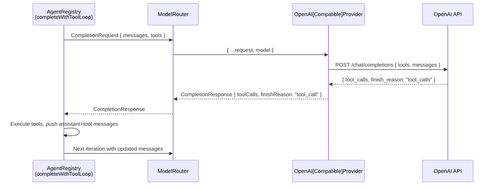

# Design Document: SDK Tool-Calling Pipeline Fix

## Overview

The @kernova/core SDK's tool-calling pipeline fails because the auto-detection path (`detectProvidersFromCatalog`) always creates an `OpenAICompatibleProvider` for the 'openai' catalog entry, and that provider ignores tool-related fields entirely. This design describes the minimal, targeted changes needed to make tools flow end-to-end through the pipeline.

The fix touches 5 files across 2 packages:

1. **`openai-compatible-provider.ts`** — Add tool forwarding, response parsing, and message handling
2. **`adapter-registry.ts`** — Route 'openai' id to the dedicated `OpenAIProvider`
3. **`openai-provider.ts`** — Fix finish reason mapping for `"tool_calls"`
4. **`agent-registry.ts`** — Include `toolCalls` on assistant messages in the conversation loop
5. **`@kernova/types` model.ts** — Add optional `toolCalls` field to `ModelMessage`

The `ModelRouter` already preserves fields via object spread — no changes needed there beyond verification.

## Architecture

The tool-calling pipeline has this data flow:



Each arrow is a point where tool data can be dropped. The fix ensures no field is lost at any stage.

## Components and Interfaces

### 1. OpenAICompatibleProvider Changes

**Current state:** Maps messages with only `role` and `content`. Ignores `tools` on request and `tool_calls` on response.

**Target state:** Full tool-calling support matching the dedicated `OpenAIProvider`.

```typescript
// Message mapping — before
messages: request.messages.map(m => ({ role: m.role, content: m.content }))

// Message mapping — after
messages: request.messages.map(m => {
  const mapped: Record<string, unknown> = { role: m.role, content: m.content };
  if (m.toolCallId) mapped.tool_call_id = m.toolCallId;
  if (m.toolCalls?.length) {
    mapped.tool_calls = m.toolCalls.map(tc => ({
      id: tc.id,
      type: 'function',
      function: { name: tc.name, arguments: JSON.stringify(tc.arguments) },
    }));
  }
  return mapped;
})
```

**Request body additions:**
```typescript
// Add tools to request body when present
if (request.tools?.length) {
  body.tools = request.tools.map(t => ({
    type: 'function',
    function: { name: t.name, description: t.description, parameters: t.parameters },
  }));
}
```

**Response parsing additions:**
```typescript
// Parse tool_calls from response
const toolCalls: ToolCall[] | undefined = data.choices[0]?.message?.tool_calls?.map(tc => ({
  id: tc.id,
  name: tc.function.name,
  arguments: JSON.parse(tc.function.arguments || '{}'),
}));
```

**`OpenAIStyleResponse` interface update:**
```typescript
interface OpenAIStyleResponse {
  id: string;
  model: string;
  choices: Array<{
    message: {
      role: string;
      content: string | null;
      tool_calls?: Array<{
        id: string;
        type: string;
        function: { name: string; arguments: string };
      }>;
    };
    finish_reason: string;
  }>;
  usage?: { prompt_tokens: number; completion_tokens: number; total_tokens: number };
}
```

**`mapFinishReason` update:**
```typescript
function mapFinishReason(reason?: string): 'stop' | 'length' | 'error' | 'tool_call' {
  switch (reason) {
    case 'stop': return 'stop';
    case 'length': return 'length';
    case 'tool_calls': return 'tool_call';
    default: return 'stop';
  }
}
```

### 2. AdapterRegistry Changes

**Current state:** `case 'openai':` always creates `OpenAICompatibleProvider`.

**Target state:** If `config.id === 'openai'`, instantiate `OpenAIProvider` instead.

```typescript
case 'openai':
  if (config.id === 'openai') {
    return new OpenAIProvider({
      apiKey,
      baseUrl: config.baseUrl,
      defaultModel: config.defaultModel,
      timeoutMs: config.timeoutMs,
    });
  }
  return new OpenAICompatibleProvider({
    id: config.id,
    name: config.name,
    baseUrl: config.baseUrl,
    apiKey,
    defaultModel: config.defaultModel,
    timeoutMs: config.timeoutMs,
    headers: config.headers,
  });
```

**Rationale:** The dedicated `OpenAIProvider` already handles tool calling correctly and has OpenAI-specific optimizations. Other providers using the `'openai'` adapter (Groq, DeepSeek, etc.) continue using the generic `OpenAICompatibleProvider` which will now also support tools.

### 3. OpenAIProvider Finish Reason Fix

**Current state:** `mapFinishReason` only handles `'stop'` and `'length'`, maps everything else (including `'tool_calls'`) to `'stop'`.

**Target state:** Explicitly map `'tool_calls'` to `'tool_call'`.

```typescript
function mapFinishReason(reason?: string): 'stop' | 'length' | 'error' | 'tool_call' {
  switch (reason) {
    case 'stop': return 'stop';
    case 'length': return 'length';
    case 'tool_calls': return 'tool_call';
    default: return 'stop';
  }
}
```

Note: The return type also changes from `'stop' | 'length' | 'error'` to `'stop' | 'length' | 'error' | 'tool_call'` to match the `CompletionResponse` type.

### 4. AgentRegistry (completeWithToolLoop) Changes

**Current state:** Pushes assistant message without tool calls:
```typescript
messages.push({ role: 'assistant', content: response.content || '' });
```

**Target state:** Include `toolCalls` on the assistant message:
```typescript
messages.push({
  role: 'assistant',
  content: response.content || '',
  toolCalls: response.toolCalls,
});
```

This allows the provider to serialize the full conversation history including which tools the assistant decided to call.

### 5. ModelMessage Type Update

**Current state:**
```typescript
export interface ModelMessage {
  role: MessageRole;
  content: string;
  parts?: ContentPart[];
  toolCallId?: string;
}
```

**Target state:**
```typescript
export interface ModelMessage {
  role: MessageRole;
  content: string;
  parts?: ContentPart[];
  toolCallId?: string;
  toolCalls?: ToolCall[];
}
```

The new `toolCalls` field is optional and only populated on assistant messages that requested tool invocations.

### 6. Debug Logging

Add `console.debug` calls at key pipeline stages:

- **completeWithToolLoop**: Log tool count/names before sending to router (already partially exists with `console.log`)
- **OpenAICompatibleProvider.complete**: Log when tools are being forwarded
- **Both providers**: Log when tool_calls are parsed from response
- **Both providers**: Warn if request seems to expect tools but none received

Use `console.debug` for normal flow, `console.warn` for the missing-tools case.

## Data Models

### ModelMessage (updated)

| Field | Type | Required | Description |
|-------|------|----------|-------------|
| role | MessageRole | Yes | 'system' \| 'user' \| 'assistant' \| 'tool' |
| content | string | Yes | Text content of the message |
| parts | ContentPart[] | No | Rich multimodal content |
| toolCallId | string | No | Links tool result to its call (role='tool' only) |
| toolCalls | ToolCall[] | No | Tool invocations made by assistant (role='assistant' only) |

### OpenAI Wire Format (for reference)

Assistant message with tool calls:
```json
{
  "role": "assistant",
  "content": null,
  "tool_calls": [
    {
      "id": "call_abc123",
      "type": "function",
      "function": { "name": "get_weather", "arguments": "{\"city\":\"NYC\"}" }
    }
  ]
}
```

Tool result message:
```json
{
  "role": "tool",
  "content": "{\"temp\": 72}",
  "tool_call_id": "call_abc123"
}
```

Tool definition in request body:
```json
{
  "type": "function",
  "function": {
    "name": "get_weather",
    "description": "Get current weather",
    "parameters": { "type": "object", "properties": { "city": { "type": "string" } } }
  }
}
```

## Correctness Properties

*A property is a characteristic or behavior that should hold true across all valid executions of a system — essentially, a formal statement about what the system should do. Properties serve as the bridge between human-readable specifications and machine-verifiable correctness guarantees.*

### Property 1: Tool Spec Serialization Preserves All Fields

*For any* valid array of `ToolSpec` objects, serializing them into the OpenAI function-calling format and then extracting the name, description, and parameters from the serialized output SHALL produce values identical to the original `ToolSpec` fields.

**Validates: Requirements 1.1**

### Property 2: Tool Call Response Parsing Round-Trip

*For any* valid OpenAI-style response containing `tool_calls` (with random id, function name, and JSON-serializable arguments), parsing the response into `ToolCall[]` SHALL produce objects where `id`, `name`, and `arguments` match the original values from the wire format.

**Validates: Requirements 1.3**

### Property 3: ModelRouter Preserves All CompletionRequest Fields

*For any* valid `CompletionRequest` containing arbitrary combinations of optional fields (including `tools`, `metadata`, `temperature`, `maxTokens`, `stopSequences`, `jsonMode`), the request forwarded by `ModelRouter.complete()` to the provider SHALL contain all fields from the original request (with only `model` potentially overridden).

**Validates: Requirements 4.1, 4.2, 4.3**

### Property 4: Conversation History Serialization Preserves Tool Call Data

*For any* array of `ModelMessage` objects containing assistant messages with `toolCalls` and tool messages with `toolCallId`, serializing them into the OpenAI API format SHALL:
- Include `tool_calls` on assistant messages with each tool call's `id`, `name`, and stringified `arguments`
- Include `tool_call_id` on tool messages matching the original `toolCallId` value
- Preserve `content` on all messages

**Validates: Requirements 1.2, 5.3, 6.2, 6.3**

## Error Handling

| Scenario | Handling |
|----------|----------|
| `tool_calls[].function.arguments` is invalid JSON | Catch `JSON.parse` error, set `arguments` to `{}`, log warning |
| API returns 400 due to malformed tool definition | Propagate error with descriptive message including tool name |
| Tool execution throws in completeWithToolLoop | Already handled — catches error, returns `"Error: {message}"` as tool result |
| Max iterations reached in tool loop | Already handled — returns descriptive message |
| Provider receives request with `tools: undefined` | Log debug warning, proceed without tools (graceful degradation) |

## Testing Strategy

### Unit Tests (Example-Based)

- **Adapter Registry**: Verify `createProviderFromConfig` instantiates `OpenAIProvider` for `id: 'openai'` and `OpenAICompatibleProvider` for other ids
- **Finish Reason Mapping**: Both providers map `"tool_calls"` → `"tool_call"`, `"stop"` → `"stop"`, `"length"` → `"length"`
- **completeWithToolLoop**: Mock model returns tool_calls → verify assistant message includes `toolCalls` field
- **Debug Logging**: Mock console, verify logs emitted at correct pipeline stages

### Property-Based Tests (fast-check)

Property-based testing is appropriate here because the core logic involves data transformation (serialization/deserialization) with large input spaces. The transformations are pure functions operating on structured data.

**Library:** [fast-check](https://github.com/dubzzz/fast-check) (TypeScript PBT library)
**Configuration:** Minimum 100 iterations per property test

Each property test must be tagged with:
```
// Feature: sdk-tool-calling-fix, Property {N}: {property_text}
```

- **Property 1**: Generate random `ToolSpec[]` → serialize → verify all fields preserved
- **Property 2**: Generate random OpenAI-style `tool_calls` responses → parse → verify round-trip correctness
- **Property 3**: Generate random `CompletionRequest` with various fields → pass through mock router → verify all fields forwarded
- **Property 4**: Generate random `ModelMessage[]` with tool call history → serialize → verify format correctness

### Integration Tests

- End-to-end test with mocked HTTP: `completeWithToolLoop` → `ModelRouter` → `OpenAIProvider` → mock server returns tool_calls → verify full loop completes
- Verify `detectProvidersFromCatalog` with `OPENAI_API_KEY` set returns an `OpenAIProvider` instance
